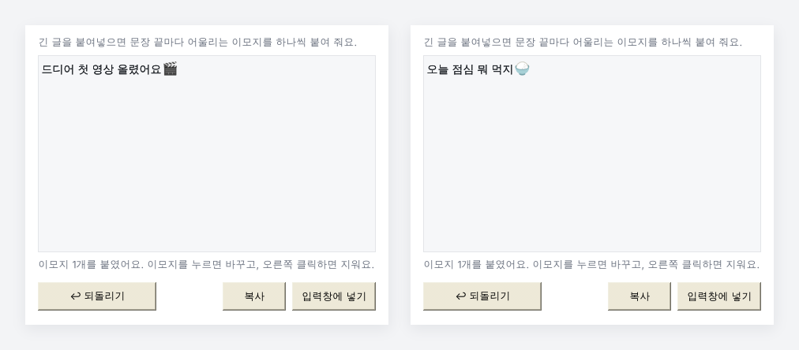
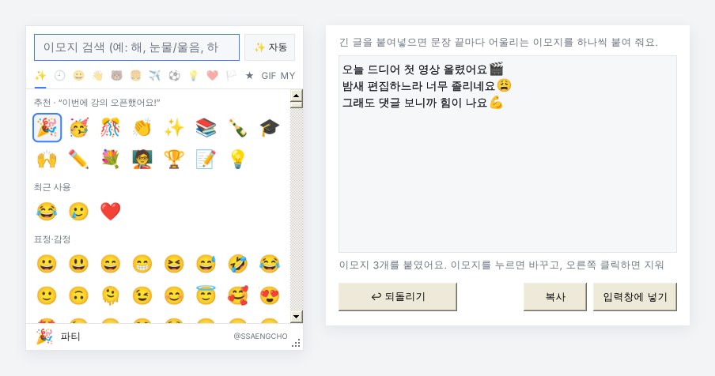
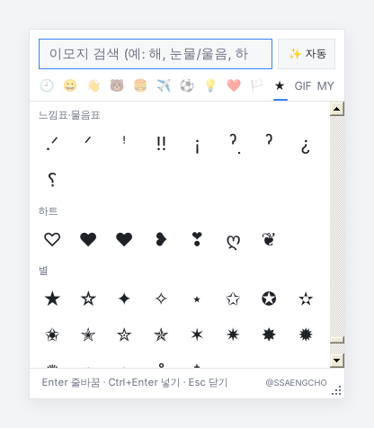

<div align="center">


# EmoGIF Picker

**톡방이나 SNS에 올릴 글을 이모지로 더 예쁘게 ✨**

`Ctrl` + `Win` + `.` 한 번이면 어디서든 이모지 · GIF · 특수문자를 바로 넣어요.

[**⬇️ Windows용 무료 다운로드**](../../releases/latest) &nbsp;·&nbsp; [📱 휴대폰 웹앱](https://emoji-picker-mobile.soldaeng-guri.chatgpt.site)


</div>

## 이런 걸 할 수 있어요

### 💬 글을 더 예쁘게
쓰던 문장 뒤에 어울리는 이모지를 알아서 붙여 줘요. 짧은 한 줄도, 긴 글도 OK.



긴 글은 문장마다 하나씩, 쓰던 문장에 맞는 이모지는 맨 위에 추천해 줘요.



### 🎞️ 톡방에서 GIF 고르기
`축하`, `기쁨`처럼 한국어로 찾아서 카톡 대화창에 바로 보내요.


### ★ 특수문자
`.ᐟ ♡ ★ ✿ ◡̈ ʚɞ ʕ•ᴥ•ʔ ୨୧` 같은 감성 기호도 한 번에 넣어요.



## 쓰는 법

1. [**다운로드**](../../releases/latest) 받은 exe 파일을 더블클릭 (설치 없음)
2. 카톡이든 인스타든 글 쓰는 칸에서 `Ctrl` + `Win` + `.`
3. 고르면 끝! 커서 자리에 바로 들어가요

> "Windows의 PC 보호" 창이 뜨면 **[추가 정보] → [실행]** 을 눌러 주세요.
> Windows 10 / 11 에서 무료로 쓸 수 있어요.

<br>

<details>
<summary>개발자용 · 직접 빌드하기</summary>

```bash
sudo apt install mono-complete nodejs
cd src/emoji-picker-windows
mkdir -p dist && NOSIGN=1 bash build.sh   # → dist/EmojiPicker.exe
```

`src/emoji-picker-windows` Windows 프로그램 · `src/emoji-picker-extension` 크롬 확장 · `web` 휴대폰 웹앱

이모지: Noto Color Emoji (Apache 2.0) · 글꼴: Pretendard (OFL 1.1) · GIF: KLIPY · 기본 이모티콘 「크리에이터의 하루」 font: @aiollcut
</details>

<div align="center">

Made by **@SSAENGCHO** 쌩초

</div>
