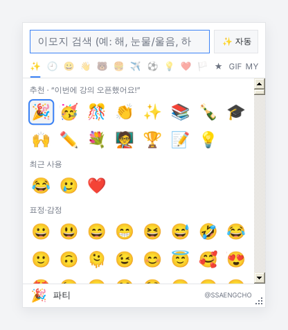
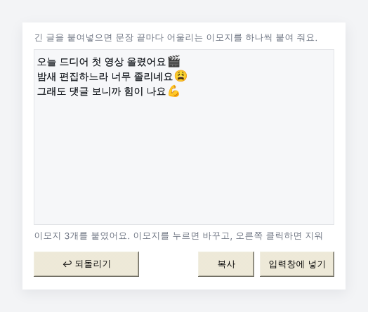
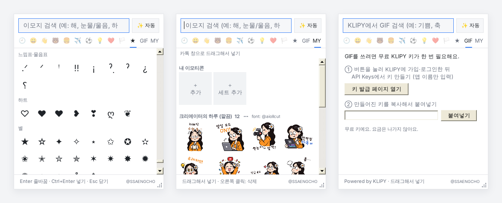

<div align="center">


# EmoGIF Picker

**어디서든 `Ctrl` + `Win` + `.` 한 번으로, 한국어로 찾아 바로 넣는 이모지 · GIF · 내 이모티콘**

카톡, 메모장, 브라우저, 한글, 워드… 글을 쓰는 곳이라면 어디서나.

[**⬇️ 다운로드 (Windows)**](../../releases/latest) &nbsp;·&nbsp; [📱 휴대폰 웹앱](https://emoji-picker-mobile.soldaeng-guri.chatgpt.site) &nbsp;·&nbsp; [사용법](#-사용법) &nbsp;·&nbsp; [자주 묻는 질문](#-자주-묻는-질문)


</div>

---

## ✨ 이런 걸 할 수 있어요

| | 기능 | 설명 |
|---|---|---|
| 🔍 | **한국어 검색** | `ㅋㅋ`, `눈물`, `하트`, `웃픈`, `축하`처럼 평소 말로 찾아요 |
| 💡 | **문장 맞춤 추천** | 쓰던 문장을 읽고 어울리는 이모지를 맨 위에 보여줘요. *"강의 오픈했어요!"* → 🎉🥳🎊👏 |
| ⌨️ | **바로 입력** | 고르면 커서 위치에 그대로 들어가요. 복사·붙여넣기 필요 없음 |
| ✨ | **이모지 자동 붙이기** | 긴 글을 붙여넣으면 문장 끝마다 어울리는 이모지를 하나씩 붙여줘요 |
| ★ | **특수문자** | `.ᐟ ♡ ★ ✿ ◡̈ ❶ ♪ ʚɞ ʕ•ᴥ•ʔ ୨୧` 같은 감성 기호 |
| 🎞️ | **GIF 검색** | 한국어로 검색해서 움직이는 GIF를 바로 보내요 (무료 키 필요) |
| 🖼️ | **MY 내 이모티콘** | 내 사진·그림을 등록하면 배경을 투명하게 다듬어 세트로 정리해요 |
| 🤖 | **AI 추천 (선택)** | Google Gemini 무료 키를 넣으면 문장을 더 잘 이해해요 |

> 인터넷 없이도 이모지 검색과 문장 추천은 모두 동작해요. 쓰는 글은 어디에도 보내지 않아요. (AI 추천을 직접 켠 경우만 예외)

---

## 🚀 시작하기

1. 오른쪽 **[Releases](../../releases/latest)** 에서 `EmoGIF-Picker.exe` 를 받아요.
2. 원하는 폴더(예: 문서)에 두고 **더블클릭**하면 끝. 설치 과정이 없어요.
3. 화면 오른쪽 아래 트레이에 😀 아이콘이 생기면 준비 완료!

> **"Windows의 PC 보호" 창이 뜨면?**
> 개인이 만든 무료 프로그램이라 처음 한 번 뜰 수 있어요. **[추가 정보] → [실행]** 을 누르면 돼요.

**필요한 것:** Windows 10 또는 11 (따로 설치할 것 없음)

---

## 📖 사용법

### 기본

| 하고 싶은 것 | 방법 |
|---|---|
| 이모지 창 열기 | 아무 입력창에서 `Ctrl` + `Win` + `.` |
| 찾기 | 그대로 한국어 입력 (예: `해`, `슬퍼`, `ㅋㅋ`) |
| 넣기 | 클릭, 또는 방향키로 고르고 `Enter` |
| 여러 개 연속으로 넣기 | `Shift` + 클릭 / `Shift` + `Enter` |
| 닫기 | `Esc` |

### 💡 문장에 맞는 이모지 추천



글을 쓰다가 `Ctrl` + `Win` + `.` 을 누르면, 커서 앞 문장에 어울리는 이모지가 맨 위 **✨추천** 칸에 먼저 나와요.

- 첫 번째 추천이 이미 골라져 있어서 **`Enter`만 누르면** 바로 들어가요.
- 내장 사전으로 동작해서 인터넷이 필요 없어요.
- 비밀번호 칸이나 글을 읽을 수 없는 프로그램에서는 일반 목록이 나와요.

<br clear="right">

### ✨ 이모지 자동 붙이기



검색창 옆 **✨ 자동** 버튼을 누르고 긴 글을 붙여넣으면, 문장 끝마다 어울리는 이모지를 하나씩 붙여줘요.

- 붙은 이모지를 **클릭**하면 다른 이모지로 바꾸고, **오른쪽 클릭**하면 지워요.
- 마음에 안 들면 **↩ 되돌리기** 한 번으로 원래 글로.
- **[복사]** 또는 **[입력창에 넣기]** 로 바로 사용해요.

### 탭 줄 오른쪽 끝



#### ★ 특수문자
심플하고 귀여운 기호 모음이에요. 누르면 바로 들어가요.

#### MY · 내 이모티콘
- **[＋ 추가]** 로 사진이나 그림을 등록하면, 알맞게 줄이고 단색 배경은 투명하게 바꿔서 저장해요.
- **[＋ 세트 추가]** 로 세트를 만들어 이모티콘을 묶어 둘 수 있어요. 세트 이름 옆 `⋯` 에서 이름 바꾸기·삭제.
- **클릭** = 그림으로 붙여넣기, **끌어다 놓기** = 파일로 보내기 (투명 배경·움직임 유지)
- 오른쪽 클릭으로 삭제

#### GIF
`기쁨`, `슬픔`, `축하`처럼 한국어로 검색해서 움직이는 GIF를 넣어요.
처음 한 번만 **무료 KLIPY 키**가 필요해요.

1. GIF 탭 → **[키 발급 페이지 열기]**
2. KLIPY에 가입·로그인 → **API Keys** 에서 키 만들기 (앱 이름만 입력)
3. 만들어진 키를 복사 → **[붙여넣기]**

> 요금은 나가지 않아요. 움직임을 살리려면 GIF를 **끌어다 놓기** 해서 보내세요.

### GIF · 내 이모티콘이 들어가는 곳

그림 파일이라서, 그림 붙여넣기를 받아 주는 곳에서만 들어가요.

| ✅ 되는 곳 | ❌ 안 되는 곳 |
|---|---|
| 카카오톡 PC, 디스코드, 슬랙, 지메일·노션 등 일부 웹 편집기 | 메모장, 검색창, 일반 글 입력칸 |

### 트레이 아이콘 메뉴 (오른쪽 클릭)

| 메뉴 | 설명 |
|---|---|
| Windows 시작 시 자동 실행 | 켜 두면 컴퓨터를 켤 때마다 자동으로 대기 |
| 붙여넣기 방식으로 입력 | 어떤 프로그램에서 이모지가 안 들어가거나 깨지면 켜 보세요 |
| 문장에 맞는 이모지 추천 | 끄면 일반 목록만 보여요 |
| AI 추천 설정 (선택) | 아래 참고 |
| 종료 | 프로그램 끄기 |

아이콘을 **왼쪽 클릭**하면 피커를 열어 고른 이모지를 클립보드에 복사해요.

### 🤖 AI 추천 설정 (선택)

AI를 켜지 않아도 추천은 잘 동작해요. 더 똑똑한 추천을 원하면:

1. 트레이 아이콘 오른쪽 클릭 → **AI 추천 설정**
2. **Google Gemini (무료 키)** 선택 → **[키 발급 페이지 열기]** → Google 로그인 → **[API 키 만들기]**
3. 키 복사 → **[붙여넣기]** → **[저장]**

> - 결제 정보를 등록하지 않으면 요금은 나가지 않아요. 무료 한도를 넘으면 잠시 멈출 뿐이에요.
> - AI를 켜면 커서 앞 문장(최대 200자)이 Google로 보내지고, 무료 사용 시 서비스 개선에 쓰일 수 있어요.
> - 내 PC에서 돌리는 **Ollama** 도 고를 수 있어요 (고급).

---

## ❓ 자주 묻는 질문

<details>
<summary><b>단축키를 눌러도 아무 반응이 없어요</b></summary>

트레이에 😀 아이콘이 있는지 확인해 주세요. 다른 프로그램이 같은 단축키를 쓰고 있으면 알림이 떠요. 그럴 땐 트레이 아이콘을 눌러서 사용할 수 있어요.
</details>

<details>
<summary><b>어떤 프로그램에서는 이모지가 안 들어가요</b></summary>

트레이 메뉴에서 **붙여넣기 방식으로 입력** 을 켜 보세요. 관리자 권한으로 실행된 프로그램 안에서는 Windows 보안 정책 때문에 입력이 안 될 수 있어요.
</details>

<details>
<summary><b>창이 커서가 아닌 엉뚱한 곳에 떠요</b></summary>

커서 위치를 알려주지 않는 프로그램에서는 마우스 근처에 창이 떠요.
</details>

<details>
<summary><b>일부 이모지가 네모(□)로 보여요</b></summary>

구형 Windows 10에서는 최신 이모지(🥲 등)가 상자로 보일 수 있어요. 카톡으로 보내면 받는 사람 폰에서는 정상으로 보여요.
</details>

<details>
<summary><b>카톡에서 GIF가 안 움직여요</b></summary>

클릭하면 사진(정지 그림)으로 들어가요. 움직이게 보내려면 GIF를 카톡 대화창으로 **끌어다 놓기** 하세요. 카톡에서는 받은 GIF를 눌러야 재생돼요.
</details>

<details>
<summary><b>내 키나 설정은 어디에 저장되나요?</b></summary>

내 PC의 `%APPDATA%\EmojiPicker` 폴더에 암호화해서 저장돼요. 이 저장소나 다른 곳으로 보내지 않아요.
</details>

---

## 🛠️ 직접 빌드하기

C# WinForms(.NET Framework 4.x) 프로그램이에요. Linux + Mono 에서 빌드해요.

```bash
sudo apt install mono-complete nodejs
cd src/emoji-picker-windows
mkdir -p dist && NOSIGN=1 bash build.sh   # → dist/EmojiPicker.exe
```

- 이모지 검색 데이터는 `src/emoji-picker-extension` (data.js, picker.js) 에서 가져와요.
- 서명 없이 빌드돼요. (`signing/` 폴더는 저장소에 없어요)

### 폴더 구성

| 폴더 | 내용 |
|---|---|
| `src/emoji-picker-windows` | Windows 프로그램 소스 (C#) |
| `src/emoji-picker-extension` | 크롬 확장 프로그램 + 이모지 검색 데이터 원본 |
| `web` | 휴대폰 웹앱 (PWA) |
- 점검: `mono dist/EmojiPicker.exe --search 울음 해`

---

## 📜 크레딧

- 이모지 그림: [Noto Color Emoji](https://github.com/googlefonts/noto-emoji) (Apache License 2.0)
- 화면 글꼴: [Pretendard](https://github.com/orioncactus/pretendard) (SIL Open Font License 1.1)
- GIF 검색: [KLIPY](https://klipy.com)
- 기본 이모티콘 세트 「크리에이터의 하루」: @SSAENGCHO 쌩초 캐릭터 · 글씨 font: @aiollcut

<div align="center">

Made by **@SSAENGCHO** 쌩초

</div>
